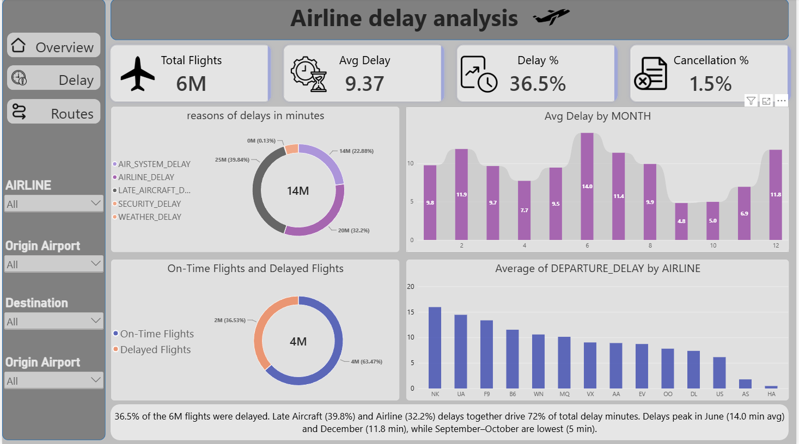

# ✈️ Airline Delay Analysis

> A data-driven study of **5.8 million US domestic flights (2015)** — uncovering why flights get delayed, which airlines and routes struggle most, and when delays peak, using **Python**, **MS SQL Server** and **Power BI**.



---

## 📌 Project Overview

This project analyzes a large airline dataset (5.8M+ flights, 30 columns) to answer key operational questions about **how often flights are late**, **why they are late**, **which airlines and routes are the worst**, and **when delays peak**. The same analysis was done in Python, SQL and Power BI, and all three were cross-checked against each other.

**Headline finding:** about 37% of flights leave late, but most delays are small. A few very long delays pull the average up, and the main causes are **late aircraft and airline problems — not weather**.

---

## 🛠️ Tools & Technologies

| Tool | Purpose |
|------|---------|
| Python (Pandas, NumPy, Matplotlib) | Data cleaning, EDA & first-pass analysis |
| MS SQL Server | Cross-check queries on the `flights` table |
| Power BI | Interactive 3-page dashboard with DAX measures |

---

## 📊 Dataset Summary

| Detail | Value |
|--------|-------|
| Total Tables | 1 (`flights`) |
| Total Columns | 30 |
| Total Rows | ~5.8 million |
| Time Period | 2015 |
| Unique Routes | 8,606 |
| Domain | Aviation / Airline Operations |

**Key columns:** `YEAR` · `MONTH` · `DAY` · `DAY_OF_WEEK` · `AIRLINE` · `ORIGIN_AIRPORT` · `DESTINATION_AIRPORT` · `DEPARTURE_DELAY` · `DISTANCE` · `CANCELLED` · `AIR_SYSTEM_DELAY` · `SECURITY_DELAY` · `AIRLINE_DELAY` · `LATE_AIRCRAFT_DELAY` · `WEATHER_DELAY`

---

## 🧹 Data Cleaning (Python)

- **Delay reason columns** (air system, security, airline, late aircraft, weather) had ~4.7M nulls. They are only filled when a flight is delayed, so nulls were replaced with `0`.
- **86,153 rows** had no `DEPARTURE_DELAY` — these flights never took off (cancelled), so they were dropped, leaving **5,732,926 rows** for the Python analysis.
- `TAIL_NUMBER`, `ARRIVAL_DELAY` and `CANCELLATION_REASON` nulls were left as they are (not used in this analysis).
- **New columns created:** `IS_DELAYED` (1 if departure delay > 0) and `ROUTE` (origin to destination).

---

## 📂 Project Structure

```
airline-delay-analysis/
│
├── data/
│   └── flights.csv
│
├── python/
│   └── airline_delay_analysis.ipynb   # Cleaning + EDA
│
├── sql/
│   └── sql_code.sql                   # 11 cross-check queries
│
├── powerbi/
│   └── airline_delay_analysis_project.pbit   # Dashboard template
│
├── reports/
│   ├── Airline_Delay_Report_v5.docx
│   ├── Airline_Delay_Presentation.pptx
│   └── Dashboard.pdf
│
└── README.md
```

---

## 🔍 SQL Analysis — Business Questions Answered

| # | Question |
|---|----------|
| 1 | Average delay per airline |
| 2 | Top 10 worst routes (highest average delay) |
| 3 | Delay reason analysis (total impact in minutes) |
| 4 | Month-wise delay trend |
| 5 | Day-of-week analysis |
| 6 | Delayed vs on-time flights count |
| 7 | Cancellation rate |
| 8 | Top 10 origin airports by average delay |
| 9 | Probability of delay by airline |
| 10 | Distance category (short / medium / long) vs delay |
| 11 | Month × airline delay breakdown |

---

## 📈 Power BI Dashboard

A 3-page dashboard (**Overview · Delay · Routes**) with side-navigation buttons and filters for **Airline, Origin Airport, Destination and Day of Week**.

**DAX measures created:** `Total Flights` · `Avg Delay` · `Delay %` · `Cancellation %` · `Delayed Flights` · `On-Time Flights` · `Severe Delays` (delay > 60 min)

**Extra columns:** `Delay Bucket` (before time / 0–15 / 15–30 / 30–60 / 60+ min), `Delay Type` (main reason of delay), `Route`

| Page | Visuals |
|------|---------|
| **Overview** | KPI cards (6M flights · 9.37 min avg delay · 36.5% delay · 1.5% cancellation), delay reasons donut, avg delay by month, on-time vs delayed donut, avg delay by airline |
| **Delay** | Delayed / on-time / severe delay KPIs, airlines with most severe delays, flight distribution by delay duration, delay type, airports with most severe delays |
| **Routes** | Distance vs delay scatter, top 10 worst routes, busiest routes |

---

## 💡 Key Insights

### ⏱️ Overall Picture
- **37.08%** of flights departed late (after removing cancelled flights)
- Average departure delay is **9.4 min**, but the **median is −2 min** — most flights leave on time or early
- **75% of flights** have a delay of 7 minutes or less; the maximum is 1,988 minutes
- **1.54%** of flights (89,884) were cancelled

### 🛩️ Delay Reasons (share of delay minutes)
Late Aircraft **39.8%** → Airline **32.2%** → Air System **22.9%** → Weather **4.9%** → Security **0.1%**

> Late aircraft + airline delays together drive **~72%** of all delay minutes.

### 🏢 Airlines
| Airline | Avg Delay (min) |
|---------|-----------------|
| Spirit (NK) | 15.94 |
| United (UA) | 14.44 |
| Frontier (F9) | 13.35 |
| ... | ... |
| Alaska (AS) | 1.79 |
| Hawaiian (HA) | 0.49 |

United has the **highest chance of delay (~50%)**, then Southwest (45%) and Spirit (44%). Alaska is lowest (25%). Southwest has a lower average delay than Spirit, but is late more often.

### 📅 Seasonal & Weekly Pattern
- **Worst months:** June (13.99 min), February (11.89), December (11.78), July (11.39)
- **Best months:** September (4.82) and October (4.98)
- **Worst day:** Monday · **Best day:** Saturday

### 🚨 Severe Delays (60+ min)
- **324K flights** (~6% of all flights) were delayed by more than an hour
- **Top airports:** ORD → ATL → DFW
- Most severe delays by airline: WN (66K), UA (40K), AA (39K) — *counts, so bigger airlines show bigger numbers*

### 🗺️ Route Outliers
IAD → TTN (~341 min) → SWF → PBI (~256) → RDU → IND (~209) → SGF → HYS (~206)

The busiest routes (SFO–LAX, LAX–SFO, JFK–LAX) do **not** have high average delays. Distance also has little effect on delay.

---

## ✅ Cross-Check: Python vs SQL vs Power BI

| Metric | Python | SQL | Power BI |
|--------|--------|-----|----------|
| Avg delay | 9.4 min | Same ranking (INT rounding) | 9.37 min |
| Cancellation rate | 1.54% | 1.54% | 1.5% |
| Delay % | 37.08% | 36.5% | 36.5% |
| Worst route | IAD → TTN | IAD → TTN | IAD → TTN |

*The delay % differs because Python removes cancelled flights first, while SQL and Power BI count them in the total.*

---

## 🎯 Recommendations

1. Reduce late-aircraft chain delays with tighter turnaround monitoring
2. Prioritize airline-controlled delay causes before weather interventions
3. Plan extra capacity and recovery playbooks for June and winter peaks
4. Rank routes only after filtering for a minimum number of flights
5. Track both **average delay** and **probability of delay** by airline

---

## ⚠️ Limitations

- Worst-route averages can be inflated by routes with very few flights (a minimum-flight filter is needed)
- Some airport codes are numeric (e.g. 10581–12953) instead of 3-letter codes
- SQL averages are whole numbers because the delay column is `INT`; Python values are more exact
- Data covers **2015 only**

---

## 🚀 How to Run

1. **Clone the repository**
   ```bash
   git clone https://github.com/your-username/airline-delay-analysis.git
   ```

2. **Load `flights.csv`** into MS SQL Server (database: `airline_delay`, table: `flights`)

3. **Convert the delay reason columns to `INT`** and run the queries from `sql/sql_code.sql`

4. **Open** `powerbi/airline_delay_analysis_project.pbit` in Power BI Desktop and connect it to your data source

---

## 📁 Dataset Schema

| Group | Columns |
|-------|---------|
| Date | YEAR, MONTH, DAY, DAY_OF_WEEK |
| Flight | AIRLINE, FLIGHT_NUMBER, TAIL_NUMBER, ORIGIN_AIRPORT, DESTINATION_AIRPORT, DISTANCE |
| Timing | SCHEDULED_DEPARTURE, DEPARTURE_TIME, DEPARTURE_DELAY, TAXI_OUT, WHEELS_OFF, SCHEDULED_TIME, ELAPSED_TIME, AIR_TIME, WHEELS_ON, TAXI_IN, SCHEDULED_ARRIVAL, ARRIVAL_TIME, ARRIVAL_DELAY |
| Status | DIVERTED, CANCELLED, CANCELLATION_REASON |
| Delay Reasons | AIR_SYSTEM_DELAY, SECURITY_DELAY, AIRLINE_DELAY, LATE_AIRCRAFT_DELAY, WEATHER_DELAY |

---

## 📧 Contact

**Shivanshu**
- 📧 Email: shivanshubhardwaj0403@gmail.com
- 💼 LinkedIn: https://www.linkedin.com/in/shivanshu-bhardwaj-884243417/
- 🐙 GitHub: github.com/shivanshubhardwaj0403/

---

⭐ *If you found this project helpful, please give it a star!*
